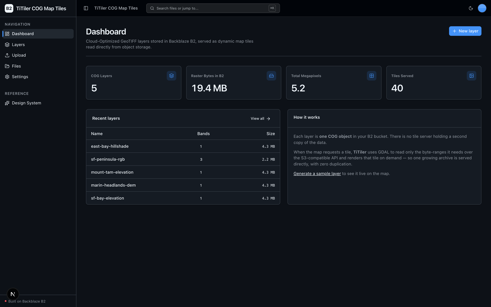
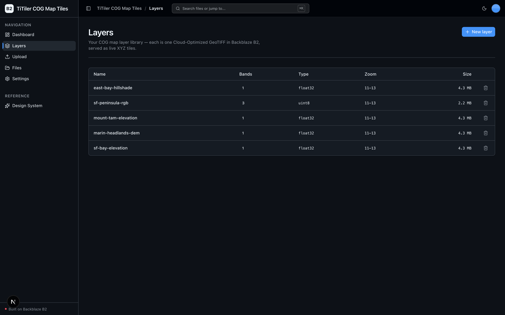
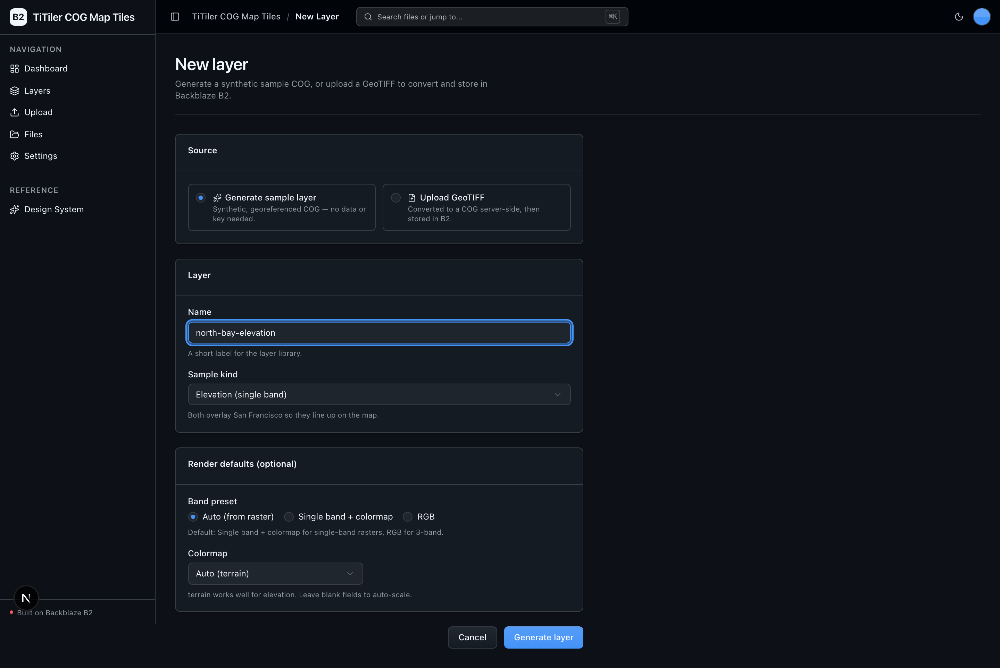
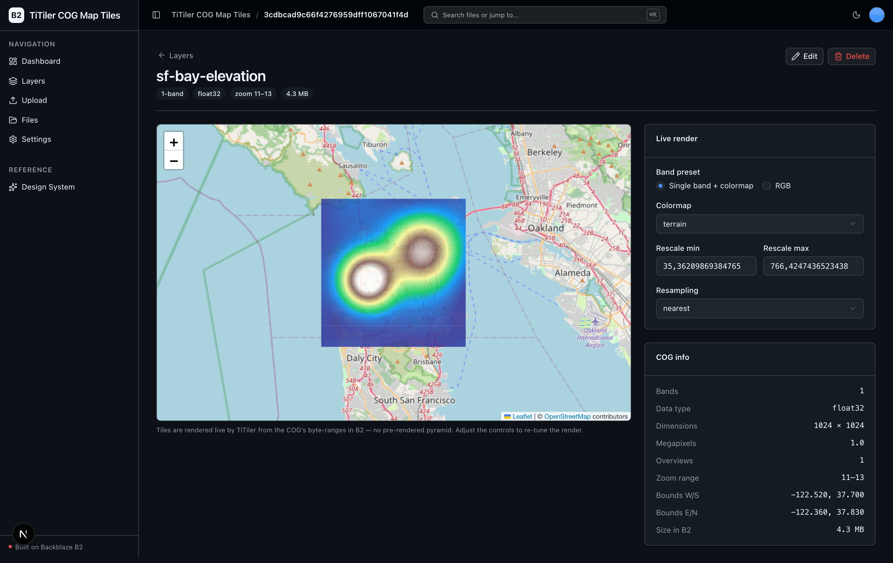
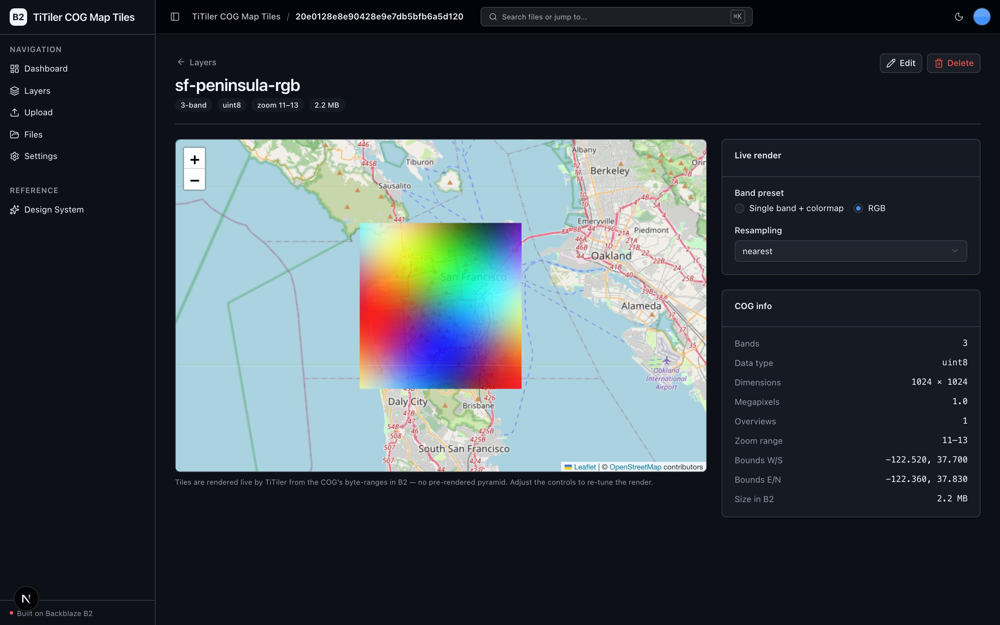

<!-- last_verified: 2026-08-11 -->
# TiTiler COG Map Tiles

Serve dynamic **XYZ map tiles** straight from **Cloud-Optimized GeoTIFFs (COGs)**
stored in **[Backblaze B2](https://www.backblaze.com/sign-up/ai-cloud-storage?utm_source=github&utm_medium=referral&utm_campaign=ai_artifacts&utm_content=b2ai-titiler-cog)** — no
intermediate tile server holding a second copy of the data. [TiTiler](https://github.com/developmentseed/titiler)
(FastAPI + rio-tiler + GDAL) reads only the COG byte-ranges it needs from B2 over
the **S3-compatible API** and renders each tile on demand, so one growing raster
archive (50–500 GB per mission) is served directly, with **zero duplication**.

This is a full-stack sample for **geospatial platform teams and mapping
developers**: ingest a raster (converted to a COG and uploaded to B2), browse the
layer library, tune render settings, view it live on an interactive Leaflet map,
and delete it — all with **B2 credentials only. No second API key, no external
model, no GPU.**

Explore the official [Backblaze B2 AI integrations and sample applications](https://www.backblaze.com/cloud-storage/b2-ai-integrations?utm_source=github&utm_medium=referral&utm_campaign=ai_artifacts&utm_content=b2ai-titiler-cog) directory and the checked-in [local OpenAPI contract](docs/api/openapi.json).

**What you get out of the box:**
- A **Layer** lifecycle end-to-end — create (upload GeoTIFF → COG, or generate a synthetic sample), read (library + detail), edit (render config), delete, and run (live map).
- **Dynamic tile serving** — TiTiler mounted as a sub-app, reading COG Range-GETs from B2 through GDAL's `/vsis3/`.
- **Interactive map viewer** — Leaflet (keyless OpenStreetMap base tiles) with live band/colormap/rescale controls.
- **Geospatial dashboard** — number of layers, total raster bytes in B2, total megapixels, and tiles served.
- Full-stack scaffold: Next.js 16 + React 19 + Tailwind v4 + shadcn/ui frontend, FastAPI backend with strict layered architecture, an OpenAPI contract test, and agent-optimized docs.

## What it looks like

**Dashboard** — geospatial metrics (COG layers, raster bytes in B2, total megapixels, tiles served), a recent-layers table, and a plain-language "how it works" panel.



**Layer library** — every COG layer in B2 as one row, showing band count, pixel type, zoom range, and size, each served as live XYZ tiles.



**New layer** — generate a synthetic georeferenced COG (no data or key needed) or upload a GeoTIFF, with render defaults for band preset and colormap.



**Layer map (single band + colormap)** — an elevation COG painted live over San Francisco on Leaflet with a terrain colormap, alongside live rescale/resampling controls and COG info read from B2.



**Layer map (RGB)** — a three-band COG rendered as an RGB composite from the same B2 byte-ranges, showing the alternate render path with no colormap.



## Quick Start

You need: Node.js >= 20, pnpm >= 9, Python >= 3.12, and a free **[Backblaze B2 account](https://www.backblaze.com/sign-up/ai-cloud-storage?utm_source=github&utm_medium=referral&utm_campaign=ai_artifacts&utm_content=b2ai-titiler-cog)**. `rasterio` wheels bundle GDAL, so there is **no system GDAL/PROJ install** on macOS arm64 or Linux.

### Setup

**1. Run setup**

```bash
pnpm run setup
```

This copies `.env.example` to `.env` (only when `.env` does not already exist),
installs workspace dependencies from `pnpm-lock.yaml`, creates
`services/api/.venv` if missing, validates that an existing venv uses Python
3.12+, and installs the API's committed Python 3.12 resolution from
`services/api/requirements.lock` (including `titiler.core`, `rio-tiler`,
`rasterio`, and `rio-cogeo`). Safe to rerun; never overwrites an existing `.env`.

> Use the `pnpm run` form: `setup` (like `doctor`) is a built-in pnpm command
> before pnpm 11, so bare `pnpm setup` would run pnpm's own command instead of
> this script.

**2. Add your B2 credentials**

Open `.env` and fill in the canonical `B2_*` values. From the [Backblaze B2 dashboard](https://secure.backblaze.com/b2_buckets.htm?utm_source=github&utm_medium=referral&utm_campaign=ai_artifacts&utm_content=b2ai-titiler-cog):

1. **Create a bucket** and note:
   - **Bucket Unique Name** → `B2_BUCKET_NAME`
   - The region embedded in its endpoint (e.g. `us-west-005`) → `B2_REGION`
2. **Create an application key** with `Read and Write` permission:
   - **keyID** → `B2_APPLICATION_KEY_ID`
   - **applicationKey** → `B2_APPLICATION_KEY` *(shown once — paste it now)*

The S3 endpoint is derived as `https://s3.{B2_REGION}.backblazeb2.com`; GDAL's
tile-read path uses the same host. `B2_PUBLIC_URL_BASE` is optional.

> Walkthrough: [creating a bucket](https://www.backblaze.com/docs/cloud-storage-create-and-manage-buckets?utm_source=github&utm_medium=referral&utm_campaign=ai_artifacts&utm_content=b2ai-titiler-cog) and [creating app keys](https://www.backblaze.com/docs/cloud-storage-create-and-manage-app-keys?utm_source=github&utm_medium=referral&utm_campaign=ai_artifacts&utm_content=b2ai-titiler-cog).

**3. Run it**

```bash
pnpm dev
```

Frontend at `localhost:3000`, API at `localhost:8000`. Open **Layers → New
layer → Generate sample layer** to create a synthetic, georeferenced COG in B2
and see it painted live on the map. Interactive API docs (Swagger UI) are at
`localhost:8000/docs`.

`pnpm dev` runs the preflight `pnpm run doctor` first — it catches the common
setup gotchas (wrong Node/Python version, missing venv, missing or placeholder
`.env`, ports already taken) and tells you how to fix each one.

## How it works

```
Browser (Leaflet)                    FastAPI                      Backblaze B2
  │  OSM base tiles (keyless)                                         │
  │   COG tiles ─────────▶  /tiler  (mounted TiTiler) ── GDAL ──▶│  COG byte-ranges
  │  layer metadata ──────────▶  /layers (own contract) ── boto3 ────▶│  COG + sidecar JSON
```

- **Management path — boto3** (`repo/b2_client.py`, `repo/layer_store.py`):
  stores each layer's COG + a small render-config sidecar JSON, lists the
  library, and deletes. Sets `user_agent_extra="b2ai-titiler-cog"`.
- **Tile-read path — GDAL / rio-tiler** (`repo/gdal_s3.py`, `repo/cog_reader.py`):
  TiTiler reads `s3://<bucket>/<prefix>/layers/<id>.tif` byte-ranges via GDAL's
  `/vsis3/`. GDAL has no boto3 client, so its custom user agent is set via the
  `GDAL_HTTP_USERAGENT` env var — the **same** `b2ai-titiler-cog` token.

TiTiler is mounted as a **sub-app** at `/tiler`, so its raster routes stay out of
this sample's OpenAPI contract. The tiler only ever accepts a validated `layer`
id (never a raw `?url=`), which it maps to a path **inside the sample prefix** —
an SSRF-safe constraint. See [ARCHITECTURE.md](ARCHITECTURE.md).

## When to use

Use this repository when you need to serve dynamic map tiles from large rasters
you already keep (or want to keep) in object storage, without standing up and
paying for a tile server that duplicates the data. It is a working reference for
the COG-on-B2 + TiTiler pattern, with production-minded controls (strict
architecture, contract checks, tests, deployment runbooks) you can adapt.

## When not to use

Do not expect a complete hosted SaaS product. It ships no managed hosting, user
accounts, authentication, tenant isolation, or billing — the API is
single-tenant and unauthenticated by design. It is not a full GIS platform
(no vector layers, styling server, or analysis pipeline). You own the
product-specific security, operations, and compliance decisions for anything you
adapt to production.

## Core Features

- [COG Ingest](docs/features/cog-ingest.md) — GeoTIFF → valid COG (rio-cogeo, internal overviews) → B2, plus a keyless "Generate sample layer" action.
- [Tile Serving](docs/features/tile-serving.md) — TiTiler + GDAL Range-GETs from B2; the custom-UA-via-env note.
- [Map Viewer](docs/features/map-viewer.md) — Leaflet + react-leaflet@5, keyless OSM base tiles, live render controls.
- [Layer Library](docs/features/layer-library.md) — the sample-scoped explorer at `/layers`.
- [COG Info](docs/features/cog-info.md) — bounds, bands, dtype, overviews, zoom range via rio-tiler.
- [Dashboard](docs/features/dashboard.md) — geospatial metrics (layers, raster bytes, megapixels, tiles served).
- [File Browser](docs/features/file-browser.md) — the untouched full-bucket `/files` explorer, kept from the starter.
- [Design System](docs/design-system.md) — tokens, primitives, error/empty patterns. Live at `/design`.

## Tech Stack

- TypeScript, Next.js 16, React 19, Tailwind v4, shadcn/ui, Leaflet + react-leaflet@5
- TanStack Query — caching, dedup, retry for every fetch
- Python 3.12+, FastAPI, boto3, Pydantic v2, TiTiler (`titiler.core`), rio-tiler, rasterio (bundled GDAL), rio-cogeo, numpy
- Backblaze B2 (S3-compatible object storage) — the only backing store, no second copy of the data
- pnpm workspaces (monorepo)

## Commands

| Command | What it does |
|---------|-------------|
| `pnpm run setup` | Idempotently copy `.env.example` to `.env` if missing, install workspace deps, create the backend venv, install the locked API dependencies |
| `pnpm run doctor` | Preflight environment check (also runs automatically before `pnpm dev`) |
| `pnpm dev` | Start frontend + backend |
| `pnpm dev:web` | Frontend only |
| `pnpm dev:api` | Backend only |
| `pnpm contract:export` | Export deterministic FastAPI OpenAPI JSON to `docs/api/openapi.json` |
| `pnpm contract:check` | Verify the checked-in OpenAPI artifact and frontend API client route registry |
| `pnpm check:agent-docs` | Validate agent shims, command docs, CI claims, `.env` ignore coverage, and one-token branding |
| `pnpm verify` | Credential-free canonical non-live pre-PR suite — runs `check:agent-docs`, `verify:api`, then `verify:web` |
| `pnpm verify:api` | Backend half: API lint, API tests, structure tests |
| `pnpm verify:web` | Frontend half: web lint, web unit tests, web typecheck + build |
| `pnpm verify:full` | `pnpm run doctor`, then `pnpm verify`, then Playwright E2E; requires populated `.env`, local server/browser permission, and port 3000 free |
| `pnpm build` | Build frontend |
| `pnpm lint` | Lint frontend |
| `pnpm lint:api` | Lint backend (ruff) |
| `pnpm test:web` | Run frontend unit tests (vitest) |
| `pnpm test:api` | Run backend tests |
| `pnpm test:live:b2` | Opt-in real B2 connectivity test; requires `RUN_LIVE_B2_TESTS=1` and non-production credentials |
| `pnpm check:structure` | Verify layering rules |
| `pnpm test:e2e` | Playwright E2E smoke tests (run `pnpm --filter @titiler-cog-map-tiles/web exec playwright install chromium` once first) |

Run `pnpm run setup` once before local development and rerun it after pulling
dependency changes. If you add a Node dependency, run `pnpm install`; for an API
dependency, follow the reviewed refresh workflow in
[docs/dev-workflows.md](docs/dev-workflows.md#python-dependency-updates). Run
`pnpm verify` (which needs neither B2 credentials nor a browser) before opening a
PR; it needs `services/api/.venv` from setup. Use `pnpm verify:full` when you can
start the local app stack with real B2 values in `.env` and a Chromium browser
installed.

## Deploying to Vercel

This sample deploys to Vercel as **one project** using Vercel
[Services](https://vercel.com/docs/services): the Next.js web app and the FastAPI
API build from the same repo and share a single origin — the web app at `/` and
the API under `/api`. One click, one project, no CORS and no wiring two URLs
together.

[](https://vercel.com/new/clone?repository-url=https%3A%2F%2Fgithub.com%2Fbackblaze-b2-samples%2Ftitiler-cog-map-tiles&project-name=titiler-cog-map-tiles&env=B2_APPLICATION_KEY_ID,B2_APPLICATION_KEY,B2_BUCKET_NAME,B2_REGION&envDescription=B2%20credentials%2C%20bucket%2C%20and%20region&envLink=https%3A%2F%2Fgithub.com%2Fbackblaze-b2-samples%2Ftitiler-cog-map-tiles%2Fblob%2Fmain%2Finfra%2Fvercel%2FREADME.md)

Set the B2 credentials, bucket, and region. Map tiles are `` requests
(Leaflet), which are **not CORS-gated**, so the tile path needs no bucket CORS.
The web app reaches the API at the same-origin `/api` automatically, so **no
`NEXT_PUBLIC_API_URL` is needed**; the repo-root `vercel.json` declares the `web`
and `api` services. Note that COG translation is CPU work in the API function —
mind Vercel function size/timeout limits for large uploads. For the full variable
classification, security controls, `/health` verification, and rollback, follow
the [Vercel delivery contract](infra/vercel/README.md). The API is
unauthenticated and bucket-wide, so use a dedicated B2 bucket/prefix and key for
any preview. Deploying is a human-approved action — nothing here performs one for
you.

## Documentation Map

| Doc | Purpose |
|-----|---------|
| [AGENTS.md](AGENTS.md) | Agent table of contents — start here |
| [ARCHITECTURE.md](ARCHITECTURE.md) | System layout, layering, the two S3 access paths, the mounted tiler |
| [docs/features/](docs/features/) | Feature docs (COG ingest, tile serving, map viewer, layer library, COG info, dashboard) |
| [docs/app-workflows.md](docs/app-workflows.md) | Layer lifecycle user journeys |
| [docs/dev-workflows.md](docs/dev-workflows.md) | Engineering workflows and testing |
| [docs/SECURITY.md](docs/SECURITY.md) | Security principles (incl. the tiler SSRF constraint) |
| [docs/RELIABILITY.md](docs/RELIABILITY.md) | Reliability expectations |
| [docs/api/openapi.json](docs/api/openapi.json) | Checked contract for the sample's own FastAPI API |
| [infra/vercel/README.md](infra/vercel/README.md) | Vercel deployment contract |
| [docs/exec-plans/](docs/exec-plans/) | Execution plans and tech debt tracker |

## FAQ

**What does TiTiler COG Map Tiles do?**
It stores Cloud-Optimized GeoTIFFs in Backblaze B2 and serves dynamic XYZ map
tiles from them on demand with TiTiler, which reads only the COG byte-ranges it
needs over the S3 API. There is no pre-rendered tile pyramid and no second copy
of the data.

**Do I need a GPU or a second API key?**
No. Every feature is CPU-only and keyless — COG translation and tile rendering
are CPU raster work (GDAL). You provide only your B2 credentials.

**Is it free?**
The code is MIT-licensed (see [License](#license)) and Backblaze B2 offers a free
account to get started. You pay only for the B2 storage/egress you use.

**Why store rasters in B2 instead of a tile server?**
A COG is internally tiled and has overviews, so a range-reader like GDAL can fetch
just the bytes for one tile at one zoom. That means the bucket is the only copy —
no tile server holding a duplicate pyramid, and one archive scales from GBs to TBs
without a migration.

**Can I upload my own GeoTIFF?**
Yes. `/layers/new → Upload GeoTIFF` converts a georeferenced GeoTIFF to a valid COG
(with internal overviews) server-side and stores it in B2. A raster with no CRS is
rejected with a clear error.

**Does it include authentication or multi-tenant isolation?**
No. The API is single-tenant and unauthenticated by design. Add auth and
per-tenant prefixes before exposing it to multiple users.

**How do I rebrand it?**
Edit `apps/web/src/lib/app-config.ts` (`APP_NAME`, `APP_DESCRIPTION`); the title,
sidebar, and breadcrumb update everywhere.

**Where do I get help or report bugs?**
Report repository defects through [GitHub Issues](https://github.com/backblaze-b2-samples/titiler-cog-map-tiles/issues). For B2 account, billing, or API help, use [Backblaze Support](https://www.backblaze.com/help?utm_source=github&utm_medium=referral&utm_campaign=ai_artifacts&utm_content=b2ai-titiler-cog).

## Maintenance and support

Backblaze maintains this open-source sample to help developers build on B2.
Production use is possible with caution and requires your own validation. Report
repository defects through
[GitHub Issues](https://github.com/backblaze-b2-samples/titiler-cog-map-tiles/issues);
for B2 account, billing, service, or API help, use
[Backblaze Support](https://www.backblaze.com/help?utm_source=github&utm_medium=referral&utm_campaign=ai_artifacts&utm_content=b2ai-titiler-cog). This sample is not
covered by the Backblaze service level agreement, and no SLA is provided for the
repository software; any B2 service or support commitments are governed
separately by the applicable Backblaze terms and support plan.

## Contributing

Start with [AGENTS.md](AGENTS.md) — it's the map, and everything else is
discoverable from there. For local commit hooks, follow [the pre-commit workflow](docs/dev-workflows.md#pre-commit).

## License

MIT License — see [LICENSE](LICENSE) for details.

## Claude Agent B2 Skill

Manage Backblaze B2 from your terminal using natural language (list/search,
audits, stale or large file detection, security checks, safe cleanup).

Repo: [https://github.com/backblaze-b2-samples/claude-skill-b2-cloud-storage](https://github.com/backblaze-b2-samples/claude-skill-b2-cloud-storage)
